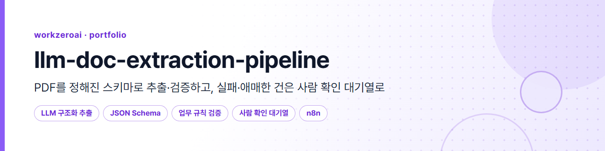

# llm-doc-extraction-pipeline

> 사람이 읽고 옮겨 적던 계약서·견적서·청구서 PDF를 **정해진 스키마(JSON Schema)로 추출하고, 코드가 다시 검증하고, 통과한 건만 저장하고, 실패하거나 애매한 건은 원인 코드와 함께 사람 확인 대기열로 넘기는** 문서 추출 파이프라인입니다. 그 결과를 정답 데이터로 **측정**합니다.

*English summary is at the [bottom](#english-summary).*

[](https://github.com/workzeroai/llm-doc-extraction-pipeline/actions/workflows/ci.yml)


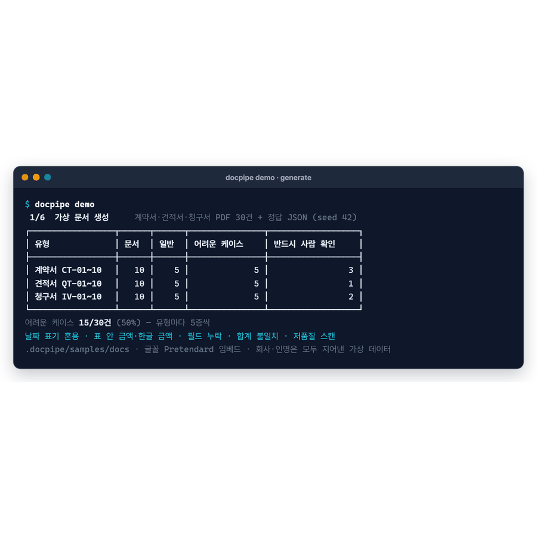

*문서·회사·인명은 모두 생성 스크립트로 만든 가상 데이터입니다. API 키 없이 도는 기본 모드는 **모의 추출기(규칙·정규식 기반 대체 구현, LLM 아님)**이고, 키를 넣으면 같은 흐름이 Gemini·Claude·OpenAI로 돕니다.*

## 문제 (Why)

- **사람이 PDF를 열어 값을 찾아 옮겨 적는다.** 계약번호·기간·금액·거래처를 건마다 눈으로 찾아 DB나 시트에 입력한다. 건수가 쌓이면 이 일이 하루를 잡아먹는다.
- **LLM에 맡기면 빨라지지만, 틀릴 때 티가 안 난다.** 그럴듯한 JSON이 나오면 사람은 믿는다. 합계가 안 맞는 문서, 필수값이 없는 문서, 흐린 스캔도 "그럴듯한 값"으로 저장되면 정산·계약 관리 단계에서야 문제가 드러난다.
- **정확도를 재지 않으면 개선도 없다.** 프롬프트를 고쳐도 좋아졌는지, 무엇을 놓치는지 알 수 없다. 그래서 추출보다 **"틀린 것을 어떻게 걸러 사람에게 넘기는가"와 "어떻게 재는가"**를 먼저 설계했다.

## 개선 전 / 후 흐름

| 개선 전 | 개선 후 |
|---|---|
| 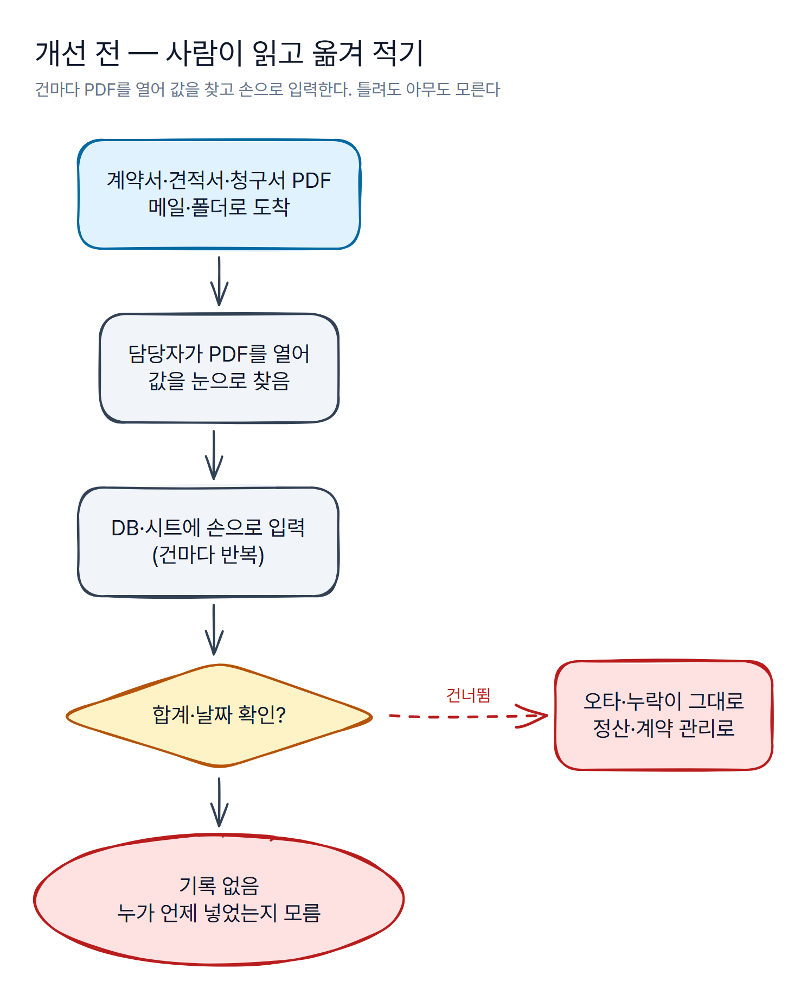 | 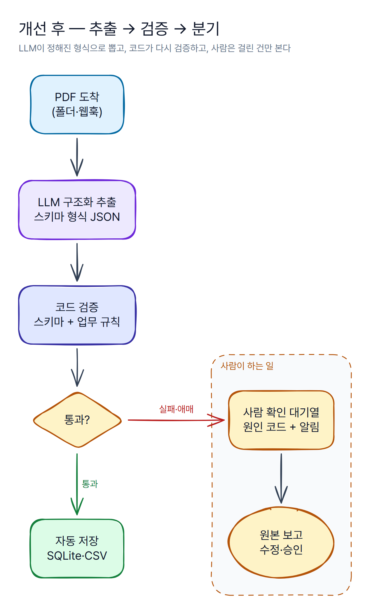 |

<!-- 도면 원본: assets/diagrams/*.excalidraw (excalidraw.com 또는 Obsidian에서 편집) · 사양: *.yaml -->

## 구조

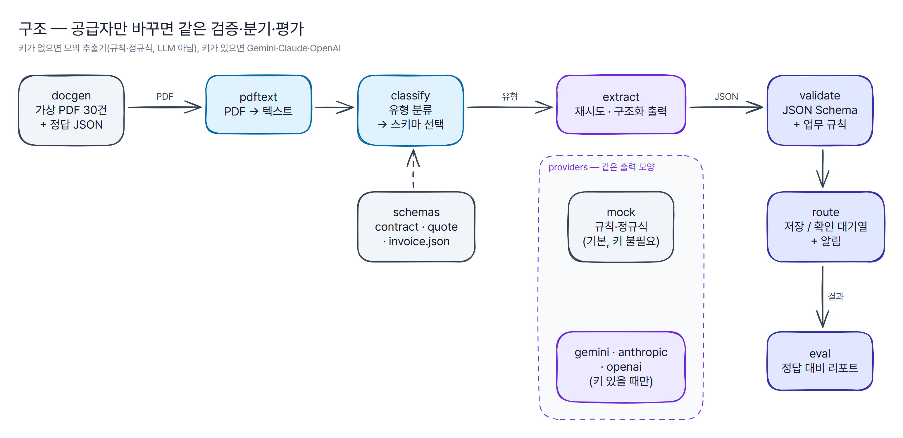

```text
llm-doc-extraction-pipeline/
├─ docgen/                # 가상 PDF 30건 + 정답 JSON 생성(reportlab, 한글 글꼴 임베드, seed 고정)
├─ schemas/               # contract.json · quote.json · invoice.json (JSON Schema 2020-12)
├─ pipeline/
│  ├─ pdftext.py          # PDF → 텍스트(pdfplumber), 텍스트 층이 없으면 실패
│  ├─ classify.py         # 유형 분류(규칙) → 스키마 선택
│  ├─ extract.py          # 공급자 호출 + 일시 오류 재시도(+ 데모용 장애 시뮬레이션)
│  ├─ providers/          # mock(기본, 키 불필요) · gemini · anthropic · openai
│  ├─ prompts.py          # 시스템 프롬프트 + 구조화 출력용 스키마 변환
│  ├─ validate.py         # JSON Schema + 업무 규칙 R01~R08 + 확신도 C01
│  ├─ route.py            # 저장(SQLite·CSV) / review_queue.csv + 알림(콘솔·웹훅)
│  ├─ run.py              # 기준 구현: python -m pipeline.run --offline
│  └─ cli.py, demo.py     # docpipe demo · run · evaluate · queue
├─ eval/                  # evaluate.py + report.md(모의 추출기 기준 결과)
├─ n8n/                   # workflow.json(가져오기용) + Code 노드 JS 원본
├─ data/samples/          # 생성본: docs/*.pdf 30건, gold/*.json 30건
├─ scripts/               # n8n 워크플로 조립, README 이미지 생성
└─ tests/                 # pytest 87개(키 없이, n8n Code 노드 JS 포함)
```

| 단계 | 하는 일 |
|---|---|
| 가상 문서 | 계약서·견적서·청구서 각 10건. 유형마다 일반 5건 + 어려운 케이스 5건(**50%**): 날짜 표기 혼용, 표 안 금액·한글 금액(`금 사천일백사십칠만원정`)·셀 안 줄바꿈, 필드 누락, 합계 불일치, 저품질 스캔(이미지만 / 잡음 섞인 OCR 층). 사업자등록번호는 검증번호까지 맞는 가상 번호. |
| 텍스트·분류 | 텍스트가 30자 미만이면 스캔 이미지로 보고 추출 단계로 보내지 않는다. 유형은 제목·핵심 낱말 점수로 고르고, 점수가 낮거나 1·2위 차이가 작으면 판별 불가로 넘긴다. |
| 추출 | 공급자는 모두 같은 출력(스키마 필드 + `uncertain_fields`)을 낸다. 실제 LLM은 구조화 출력(Gemini `response_json_schema`, Claude `output_config.format`, OpenAI `json_schema` strict)으로 형식을 강제한다. |
| 검증 | 형식(스키마) → 내용(업무 규칙) → 확신도 순. 스키마가 깨지면 규칙 계산은 하지 않는다. |
| 분기·알림 | 저장소와 확인 대기열은 **둘 중 한 곳에만** 들어간다. 대기열 건은 저장하지 않으므로 사람이 보기 전에 다음 업무로 넘어가지 않는다. |
| 평가 | 정답 JSON 대비 필드별 정확도, 문서별 완전 일치율, 사람 확인 비율, 처리 시간, **놓친 결함**, **조용한 오류**. |

### 스키마 예시 — 견적서 (`schemas/quote.json` 일부)

```json
{
  "type": "object",
  "additionalProperties": false,
  "required": ["quote_no", "issue_date", "valid_until", "supplier_name", "supplier_biz_no", "client_name",
               "manager", "items", "subtotal", "vat", "total"],
  "properties": {
    "quote_no":        {"type": ["string", "null"], "title": "견적번호"},
    "issue_date":      {"type": ["string", "null"], "format": "date", "title": "견적일"},
    "supplier_biz_no": {"type": ["string", "null"], "pattern": "^\\d{3}-\\d{2}-\\d{5}$", "title": "공급자 사업자등록번호"},
    "items": {"type": ["array", "null"], "items": {
      "type": "object", "additionalProperties": false, "required": ["name", "qty", "unit_price", "amount"],
      "properties": {"name": {"type": "string"}, "qty": {"type": "integer"},
                     "unit_price": {"type": "integer"}, "amount": {"type": "integer"}}}},
    "subtotal": {"type": ["integer", "null"], "title": "공급가액 합계"},
    "total":    {"type": ["integer", "null"], "title": "총 견적금액"}
  },
  "x-required-values": ["quote_no", "issue_date", "supplier_name", "client_name", "items", "subtotal", "vat", "total"]
}
```

- **키는 모두 필수, 값은 null 허용** → "문서에 없으면 null"을 형식으로 강제한다. 추측해서 채우면 안 된다는 뜻을 스키마가 말한다.
- `x-required-values`는 업무상 null이면 안 되는 값이다. 검증 규칙 R01이 이 목록을 읽는다.
- 실제 LLM에 넘길 때는 `prompts.llm_schema()`가 null 허용 타입을 `anyOf`로 바꾸고 `uncertain_fields`를 더한다(구조화 출력이 받는 형태).

### n8n 판 — 같은 규칙을 노코드로

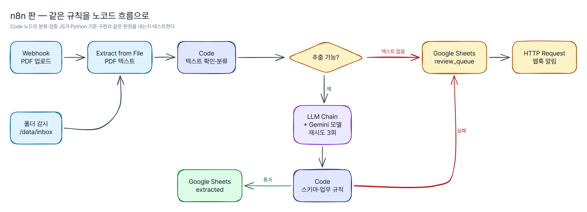

[`n8n/workflow.json`](n8n/workflow.json)을 n8n에서 **Import from File**로 가져온다(방법: [n8n/README.md](n8n/README.md)). Webhook·폴더 감시 → PDF 텍스트 추출 → Code(분류·프롬프트) → LLM Chain + Gemini(재시도 3회, 실패해도 멈추지 않고 다음 노드로) → Code(스키마·업무 규칙) → Google Sheets 저장 / 확인 대기열 → 웹훅 알림. 자격증명은 비워 두었다.

Code 노드의 JS는 `n8n/code/*.js`에 따로 두고 `scripts/build_n8n.py`가 스키마 정보를 넣어 조립한다. 테스트는 그 JS를 node로 실제 실행해 **Python 검증과 같은 판정을 내는지** 30건 + 변형 사례로 비교한다.

#### 노코드(n8n)와 코드 중 언제 무엇을

| 상황 | 고르는 쪽 | 이유 |
|---|---|---|
| 현업 담당자가 흐름을 보고 직접 고쳐야 한다, 연결할 서비스(메일·시트·메신저)가 많다 | **n8n** | 화면에서 흐름이 보이고, 자격증명·재시도·오류 분기를 노드 설정으로 해결한다 |
| 검증 규칙이 복잡하다, 정답 데이터로 회귀 테스트를 돌려야 한다, 공급자를 바꿔 가며 평가한다 | **코드** | 단위 테스트·커버리지·CI로 규칙이 깨지지 않게 지킨다 |
| 둘 다 필요하다 | **규칙은 코드에서 정의·테스트, n8n은 실행 흐름** | 이 저장소처럼 같은 규칙을 Code 노드로 옮기고, 같은 판정을 내는지 테스트로 묶는다 |

## 안전장치 — LLM이 틀릴 때를 어떻게 막는가

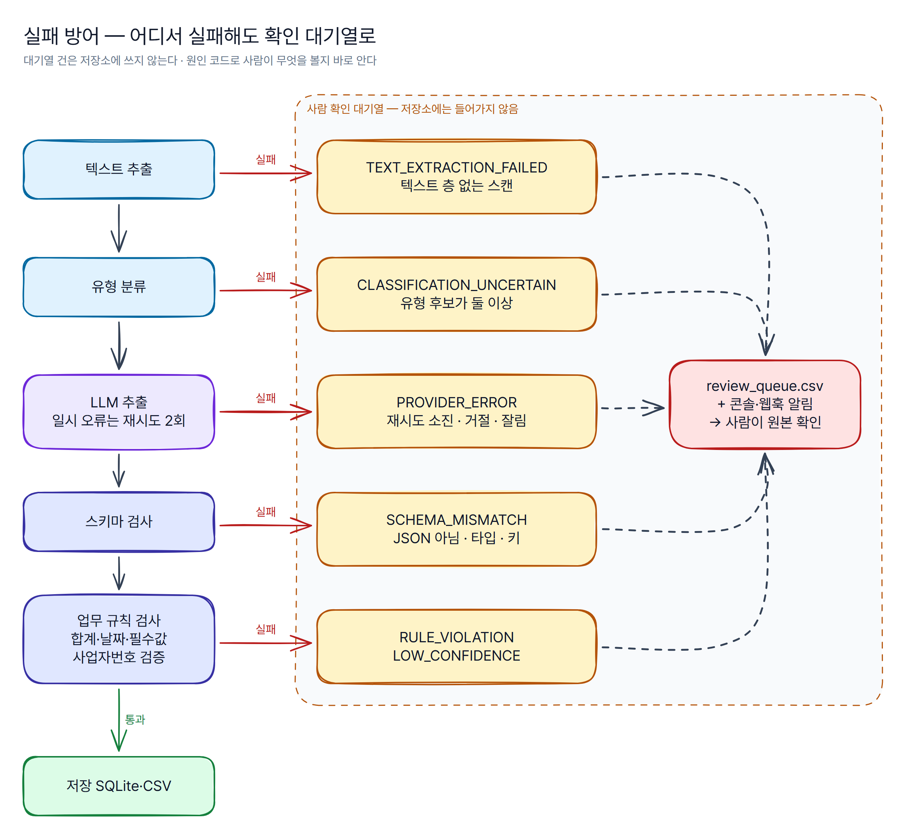

| 위험 | 장치 | 원인 코드 | 어디서 |
|---|---|---|---|
| 스캔 이미지라 텍스트가 없음 | 30자 미만이면 LLM을 부르지 않고 바로 대기열 | `TEXT_EXTRACTION_FAILED` | `pdftext.py` |
| 엉뚱한 스키마로 추출 | 유형 점수가 낮거나 후보가 둘이면 판별 불가 | `CLASSIFICATION_UNCERTAIN` | `classify.py` |
| API 장애·호출량 초과 | 429·5xx·연결 오류만 재시도(2회, 백오프), 영구 오류·거절(refusal)·잘림은 바로 실패 | `PROVIDER_ERROR` | `extract.py`, `providers/*` |
| JSON이 아니거나 형식이 다름 | 구조화 출력으로 강제 + 받은 뒤 JSON Schema로 다시 검사 | `SCHEMA_MISMATCH` | `validate.py` S01 |
| 필수값 누락 | `x-required-values`가 null이면 위반 | `RULE_VIOLATION` | R01 |
| 날짜 형식·순서 | YYYY-MM-DD·실제 날짜인지, 시작 ≤ 종료·발행 ≤ 기한 | `RULE_VIOLATION` | R02·R03 |
| 금액 오기·오인식 | 품목 금액 = 수량×단가, 소계 = 품목 합, 부가세 = 10%(±1원), 합계 = 공급가액+부가세 | `RULE_VIOLATION` | R04~R07 |
| 사업자번호 오인식 | 검증번호 계산으로 한 자리 오류도 잡음 | `RULE_VIOLATION` | R08 |
| 흐린 글자를 추측 | 추출기가 확신 없다고 표시한 필수값은 사람에게 | `LOW_CONFIDENCE` | C01 |
| 잘못된 값이 다음 업무로 | 대기열 건은 저장소에 쓰지 않음 + 콘솔·웹훅 알림, 알림 실패는 파이프라인을 멈추지 않음 | — | `route.py` |
| 비밀값 | 키는 `.env`로만(커밋 금지, `.env.example`만), 키가 없으면 실제 공급자를 만들지 않음 | — | `providers/*` |

### 설계 판단

1. **모델에게 계산을 맡기지 않는다.** 프롬프트는 "문서에 적힌 값만, 합계가 틀려 보여도 그대로"라고 요구한다. 모델이 합계를 맞춰 놓으면 문서 자체의 오류(인쇄된 합계가 틀림)가 사라지기 때문이다. 계산 검증은 코드(R04~R07)가 한다.
2. **없는 값은 null, 지어내면 오답이다.** 스키마가 모든 키를 요구하되 null을 허용하고, 평가는 "정답이 null인데 값을 낸 경우"를 오답으로 센다. 견적서 QT-08(유효기한·담당자 없음)이 그 예다.
3. **형식은 강제하고, 그래도 다시 검사한다.** 구조화 출력은 형식 오류를 크게 줄이지만 내용은 보장하지 않는다. 그래서 형식(S01) → 내용(R01~R08) → 확신도(C01) 세 겹으로 본다.
4. **실패 원인을 코드로 남긴다.** 그냥 "실패"가 아니라 `PROVIDER_ERROR`인지 `RULE_VIOLATION`인지가 보여야 사람은 원본의 어디를 볼지, 개발자는 시스템의 무엇을 고칠지 바로 안다.
5. **가장 위험한 실패는 '조용한 오류'다.** 대기열로 간 건은 사람이 본다. 위험한 것은 검증을 통과해 저장됐는데 틀린 값이다. 평가 리포트는 정확도보다 이 숫자와 "놓친 결함"을 먼저 보여 준다.

## 빠른 실행 (API 키 불필요)

```bash
git clone https://github.com/workzeroai/llm-doc-extraction-pipeline.git && cd llm-doc-extraction-pipeline
pip install -e .
docpipe demo
```

`docpipe demo` 한 번에 **가상 문서 생성 → 텍스트 추출·유형 분류 → 구조화 추출 → 검증 → 분기·알림 → 평가 리포트**까지 돕니다(`python -m pipeline.run --offline`도 같은 흐름). 공급자 장애 분기를 보여 주려고 데모에서는 QT-04(한 번 실패 후 재시도 성공)와 IV-05(재시도 소진)에 일시 오류 503을 주입합니다. 한글 TrueType 글꼴(Pretendard·나눔고딕·맑은 고딕)이 없으면 저장소의 생성본(`data/samples`)을 그대로 씁니다.

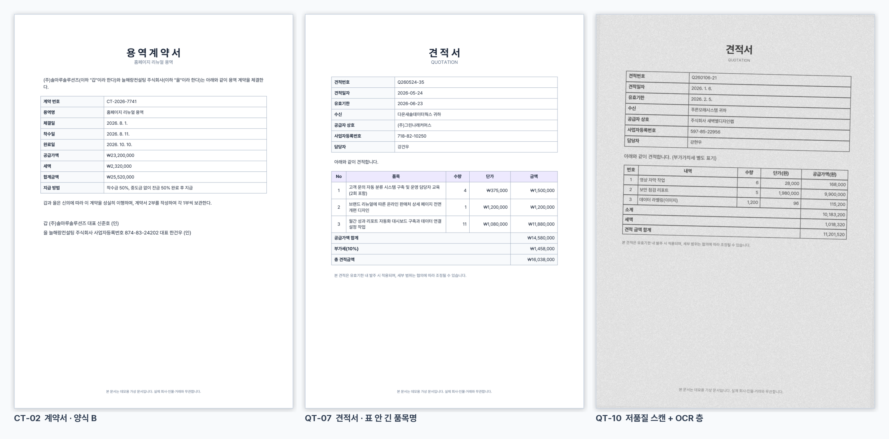

### 평가 결과 — 모의 추출기 기준

> **LLM 정확도가 아닙니다.** 아래는 키 없이 도는 **모의 추출기(규칙·정규식 기반, LLM 아님)**를 가상 문서 30건에 돌린 결과입니다. 모의 추출기는 이 저장소의 가상 양식에 맞춰 만들었으므로 필드 정확도가 높게 나오는 것이 정상이고, 여기서 볼 것은 **결함 문서가 빠짐없이 사람 확인 대기열로 가는지**입니다. 실제 LLM 평가는 키를 넣고 `python -m pipeline.run --provider gemini`(또는 `anthropic`, `openai`)로 실행하면 같은 형식의 리포트가 생성됩니다. 전체: [eval/report.md](eval/report.md)

| 지표 | 값 | 기준 |
|---|---|---|
| **반드시 확인 문서 → 확인 대기열** | **6/6**, 원인 코드 6/6 일치 | 필수값 누락 2 · 합계 불일치 3 · 텍스트 없는 스캔 1 |
| **조용한 오류(저장됐지만 틀림)** | **0건** | 자동 저장 21건 중 |
| 사람 확인 비율 | 30.0% (9/30) | 결함 6 + 저품질 스캔 2(OCR 오인식을 규칙이 잡음) + 공급자 오류 시뮬레이션 1 |
| 필드별 정확도 | 98.0% (337/344) | 추출까지 간 28건 |
| 문서별 완전 일치율 | 92.9% (26/28) | 틀린 2건은 모두 저품질 스캔이고, 둘 다 대기열로 감 |
| 평균 처리 시간 | 약 30 ms/건 | 텍스트 추출~분기, 모의 추출기·로컬 PC 기준(재시도 대기 제외) |

| 실패 방어: 결함 문서와 원인 | 단계별 터미널: 분기·알림 |
|---|---|
| 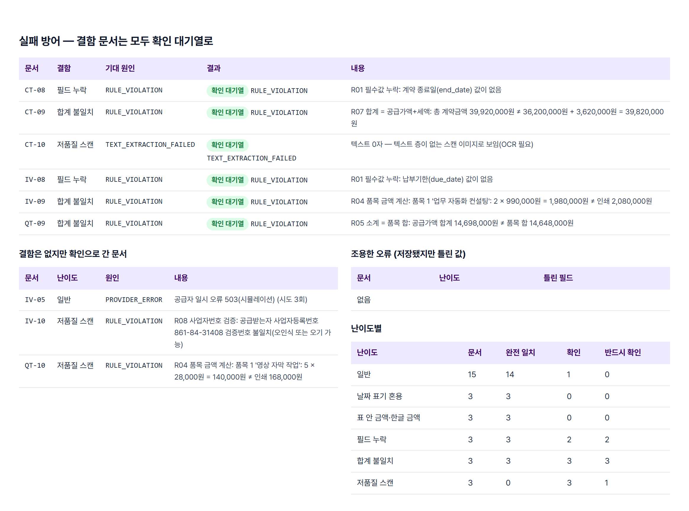 | 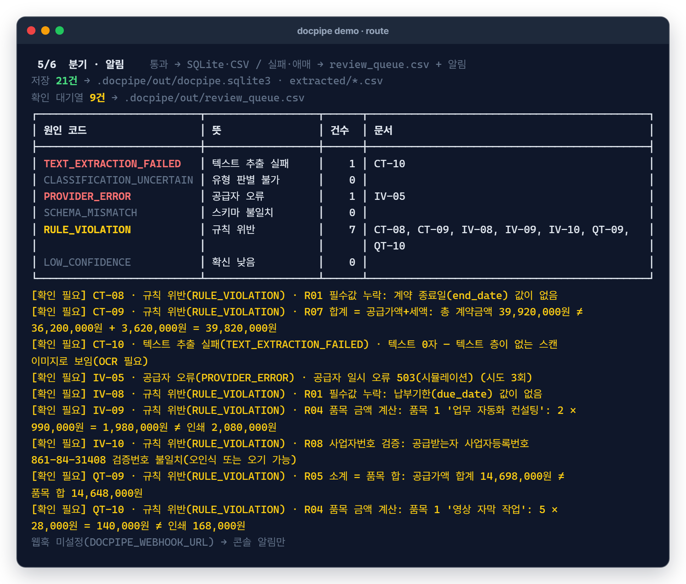 |

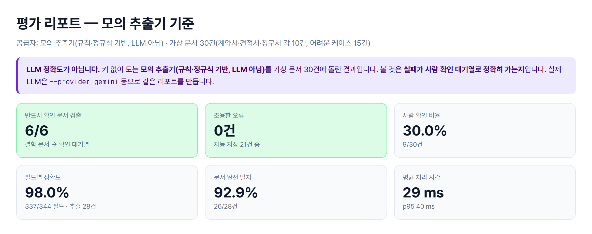

### 평가 루프

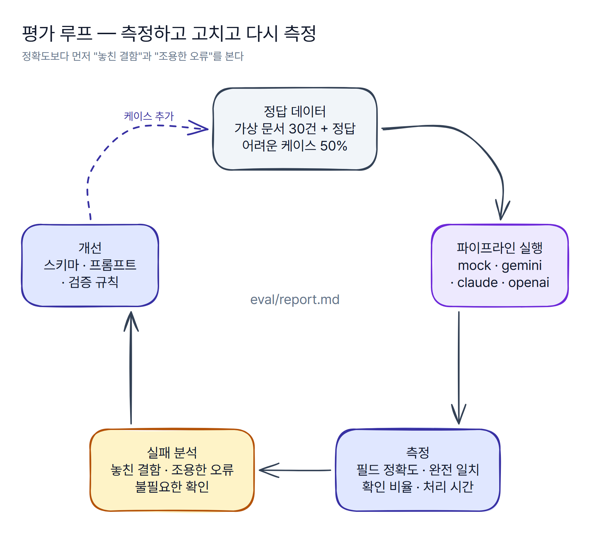

정답 데이터(어려운 케이스 50%)로 공급자를 바꿔 가며 같은 리포트를 만들고, **놓친 결함 → 조용한 오류 → 불필요한 확인 → 필드 정확도** 순으로 실패를 본 뒤 스키마(필드 정의·필수값)·프롬프트·검증 규칙을 고친다. 새로 발견한 실패 유형은 가상 문서 생성기에 케이스로 추가한다.

<details>
<summary><b>실제 LLM으로 실행하기 · 단계별 명령</b></summary>

```bash
pip install -e ".[llm]"                 # anthropic · google-genai · openai SDK
cp .env.example .env                    # 키 하나를 채운다(.env는 커밋 금지)
docpipe demo --provider gemini          # 또는 anthropic, openai — 같은 검증·분기·리포트
python -m pipeline.run --provider anthropic --report eval/report.claude.md
```

| 공급자 | 기본 모델(환경 변수로 변경) | 구조화 출력 |
|---|---|---|
| `gemini` | `GEMINI_MODEL=gemini-2.5-flash` | `response_mime_type=application/json` + `response_json_schema` |
| `anthropic` | `ANTHROPIC_MODEL=claude-opus-5-5` (`ANTHROPIC_EFFORT=low`) | `output_config.format` json_schema, 거절 시 서버 측 대체 모델(`fallbacks`) |
| `openai` | `OPENAI_MODEL=gpt-4.1-mini` | `response_format` json_schema(strict) |

```bash
docpipe generate --out data/samples     # 가상 문서 다시 만들기(seed 42, 같은 결과)
docpipe run --docs data/samples/docs    # 평가 없이 파이프라인만
docpipe queue                           # 사람 확인 대기열 보기
docpipe evaluate --results .docpipe/out/results.jsonl --gold data/samples/gold --html report.html
DOCPIPE_WEBHOOK_URL=<수신 웹훅 URL> docpipe demo   # 대기열 알림을 Slack·Discord 웹훅으로
```

개발: `pip install -e ".[dev]" && pytest && ruff check .` · README 이미지: `pip install -e ".[assets]" && python scripts/make_demo_assets.py --kit ../_design`
</details>

## 실무 적용 사례

> 아래 수치는 **회사 운영 결과이며 이 저장소 데모와 무관합니다.** 같은 설계 아이디어(LLM 구조화 추출 → 검증 → 실패는 사람 확인)를 회사 업무에 적용한 결과이고, 이 저장소는 그 아이디어를 가상 데이터로 처음부터 다시 구현한 것입니다. 회사 코드·문서·워크플로는 쓰지 않았습니다.

- LLM 계약서 PDF 자동 입력: 누적 약 1,145건, 건당 1~3분(수기 추정) → 10~15초
- 읽기 실패·누락은 상태 표시와 오류 알림으로 사람 확인에 넘김

## 한계와 다음 단계

**한계**

- **이 저장소의 정확도 수치는 모의 추출기 기준입니다.** API 키가 없는 환경에서 만들었기 때문에 실제 LLM 평가는 아직 돌리지 않았고, 녹화된 LLM 응답도 넣지 않았습니다. 공급자 어댑터는 가짜 클라이언트로 요청 모양·응답 해석·오류 분류만 테스트했습니다.
- **가상 문서 30건은 작고 양식이 고정돼 있습니다.** 실제 문서는 양식이 훨씬 다양하고 여러 쪽이며, 도장·손글씨·병합된 표가 있습니다.
- **스캔 이미지 OCR은 하지 않습니다.** 텍스트 층이 없으면 바로 사람 확인으로 넘깁니다.
- 문자열 필드(회사명·인명)의 한두 글자 오인식은 규칙으로 잡을 수 없습니다. 이번 데모의 두 스캔 문서는 금액·사업자번호 규칙에 함께 걸려 대기열로 갔을 뿐입니다.
- n8n 워크플로는 구조 테스트와 Code 노드 JS 실행 테스트까지 했고, 실제 n8n 인스턴스에서 실행해 보지는 않았습니다.

**다음 단계**

- **실제 LLM 평가:** Gemini·Claude·OpenAI로 같은 30건을 돌려 공급자별 리포트를 나란히 비교하고, 놓친 결함·조용한 오류 기준으로 프롬프트와 스키마를 고친다.
- **OCR:** 텍스트 층이 없는 스캔은 OCR 또는 비전 입력(PDF를 그대로 모델에 전달)으로 처리하고, 그 결과도 같은 검증을 거치게 한다.
- **거래처 마스터 대조:** 회사명·사업자번호를 거래처 목록과 대조해 문자열 오인식(조용한 오류의 남은 길)을 막는다.
- **확인 화면:** 대기열 건을 원본 PDF 옆에 띄워 고치고 승인하는 화면, 수정 결과를 정답 데이터로 다시 쌓기.

---

## English summary

**llm-doc-extraction-pipeline** turns contract, quotation and invoice PDFs into schema-bound JSON, **re-validates every value in code**, stores only what passes, and routes anything that fails or looks uncertain to a **human review queue with a reason code** (`TEXT_EXTRACTION_FAILED`, `CLASSIFICATION_UNCERTAIN`, `PROVIDER_ERROR`, `SCHEMA_MISMATCH`, `RULE_VIOLATION`, `LOW_CONFIDENCE`) plus console/webhook alerts. Validation is layered: JSON Schema (types, required keys, nullable-but-present fields), business rules (line amount = qty × unit price, subtotal = sum of lines, VAT = 10%, total = supply + VAT, ISO dates and date order, required values, Korean business-registration checksum) and extractor confidence. The model is never asked to compute totals, so document errors are not silently "fixed".

Providers are pluggable (Gemini, Claude, OpenAI via structured outputs, called only when an API key is present). Without keys, the default is a **rule/regex-based mock extractor — not an LLM** — so `pip install -e . && docpipe demo` runs end to end: generate 30 synthetic PDFs (50% hard cases: mixed date formats, amounts inside tables or written in Korean numerals, missing fields, total mismatches, noisy scans) → classify → extract → validate → route → evaluation report. With the mock extractor, all 6 defective documents went to the review queue with the expected reason code and none of the 21 saved documents contained a wrong value; these are mock-extractor numbers, not LLM accuracy. Running with `--provider gemini|anthropic|openai` produces the same report for a real model. An importable n8n workflow mirrors the same rules, and its Code-node JavaScript is tested against the Python validator. 87 pytest tests, 96% coverage, ruff-clean; CI runs the offline evaluation. The "in production" figures above come from the author's real work and are unrelated to this demo.

---

MIT © workzeroai
